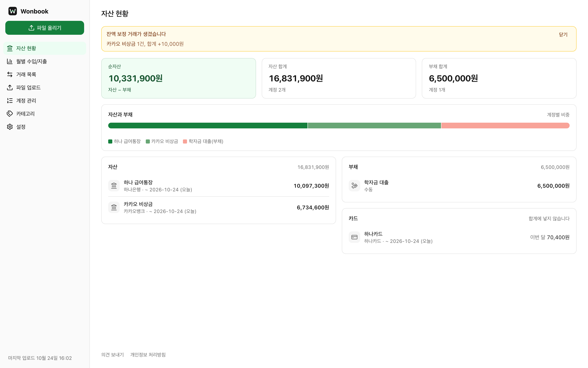
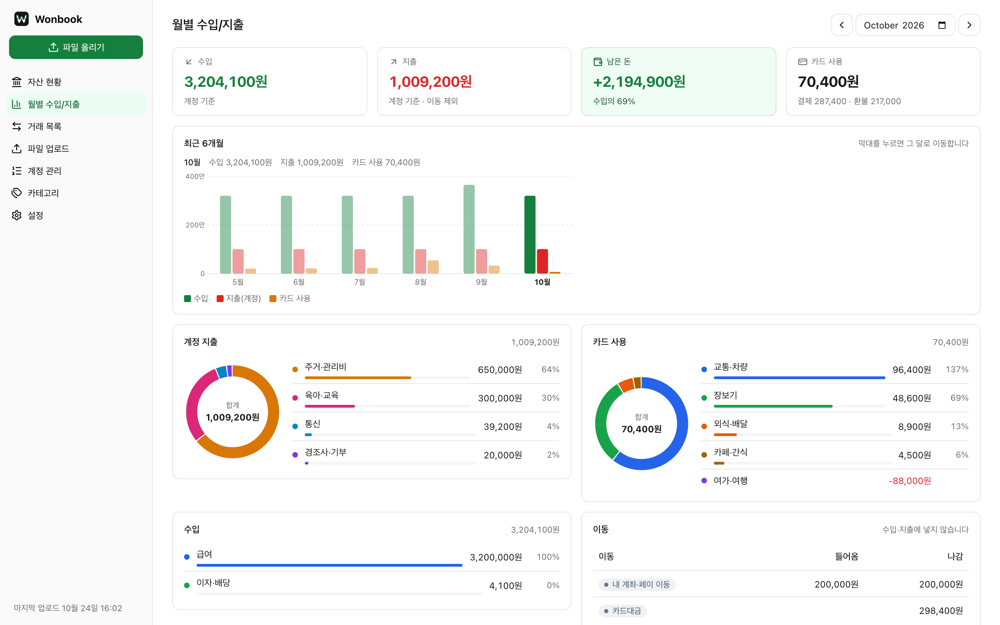
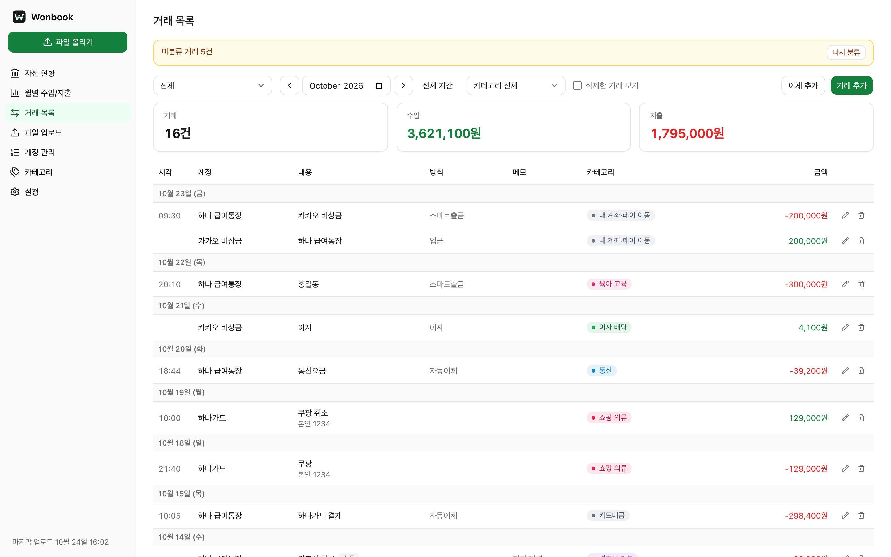
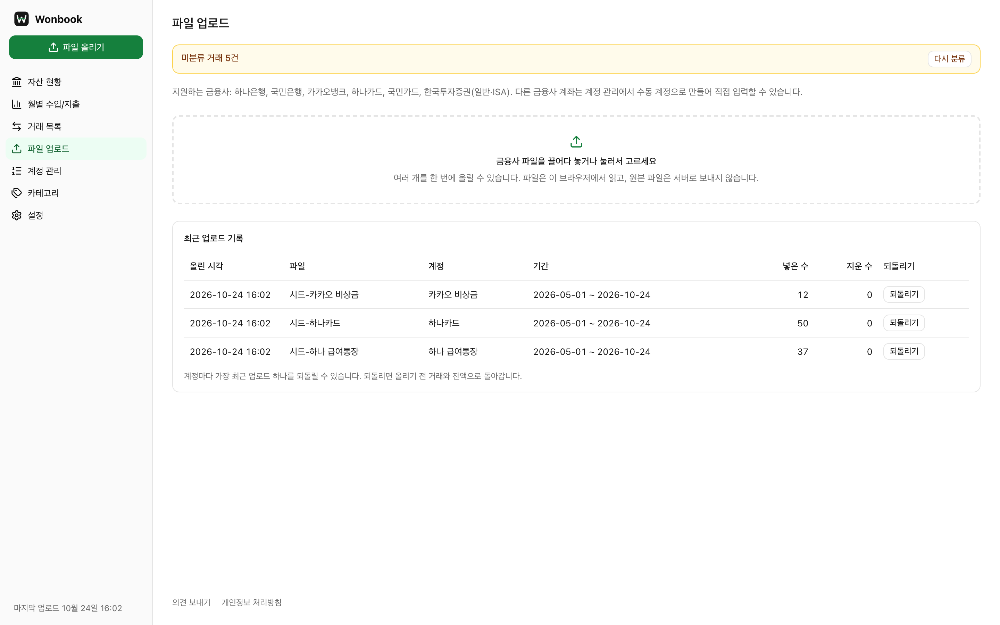
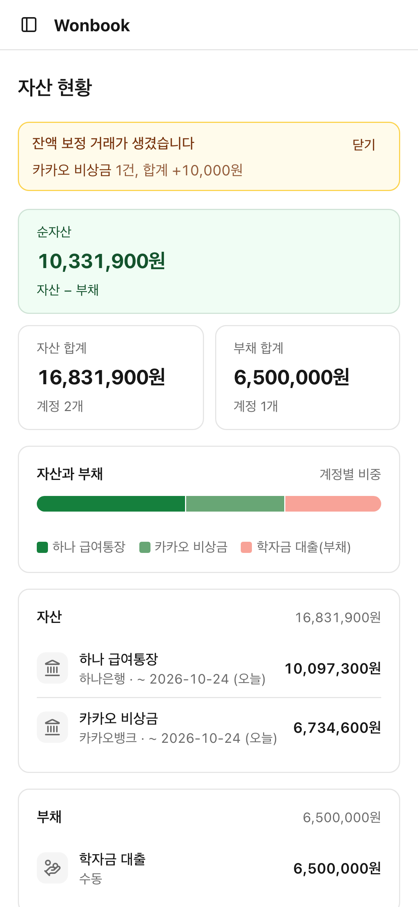
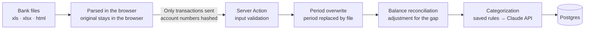

<div align="center">


<h1>Wonbook</h1>

**A web-based household ledger: upload the transaction files from your bank, and entry, categorization, and balance reconciliation are done for you**

[](https://github.com/mivomad33/wonbook/actions/workflows/ci.yml)
[](https://wonbook.vercel.app/demo)
[](https://nextjs.org)
[](https://www.typescriptlang.org)
[](https://neon.com)

[Live site](https://wonbook.vercel.app) · [Live demo](https://wonbook.vercel.app/demo) · [Features](#features) · [How it works](#how-it-works) · [Getting started](#getting-started) · [Development guide](DEVELOPMENT.en.md)

[한국어](README.md) | **English**

</div>

<br>

<p align="center">
  
</p>

## About

With typical household ledger apps, you have to enter and tidy up every bank, card, and brokerage transaction by hand. With Wonbook, you upload the transaction files you downloaded from your financial institutions as they are, and it takes care of the rest.

1. Download the transaction history files (xls, xlsx, html) from your bank's website.
2. Drag and drop them into Wonbook. You can upload several files at once.
3. Transaction entry, duplicate cleanup, categorization, and balance reconciliation happen automatically.

Sign up with a Google account, or browse the [demo](https://wonbook.vercel.app/demo) with fake data without logging in. The app UI is in Korean and supports Korean financial institutions.

## Features

- **Files are read in the browser**: Bank files (including password-protected xlsx) are parsed in the browser, and only the parsed transactions are sent to the server. The original files never leave the browser.
- **Period overwrite**: Uploading the same period again replaces that period with the file's contents. You never have to remember how far you uploaded, nothing is duplicated, and you are asked to confirm only when transactions you edited by hand would be removed. The latest upload of each account can be undone.
- **Automatic balance reconciliation**: If the balance in the file differs from the computed balance, an adjustment transaction is added and you are notified.
- **AI categorization**: Transactions are categorized automatically from their descriptions (Claude API). A category you correct once is reused for the same merchant.
- **Clear overviews**: Assets overview, monthly income/expenses (six-month trend, share by category), and a transaction list grouped by date.
- **Accounts and categories**: Institutions without file upload, or items such as money lent to someone, are kept as manual accounts. Each category has its own color and icon.
- **Export and account deletion**: Transactions can be exported as CSV, and deleting your account removes your data.

### Supported institutions

| Type | Institutions |
| --- | --- |
| Banks | Hana Bank (하나은행), KB Kookmin Bank (국민은행), KakaoBank (카카오뱅크) |
| Cards | Hana Card (하나카드), KB Kookmin Card (국민카드) |
| Brokerage | Korea Investment & Securities (한국투자증권, regular and ISA) |

Accounts at other institutions can be created as manual accounts and entered by hand.

## Screenshots

<table>
  <tr>
    <td width="50%"></td>
    <td width="50%"></td>
  </tr>
  <tr>
    <td align="center">Monthly income/expenses: six-month trend and share by category</td>
    <td align="center">Transactions: grouped by date, with category colors</td>
  </tr>
  <tr>
    <td width="50%"></td>
    <td width="50%" align="center"></td>
  </tr>
  <tr>
    <td align="center">File upload: several files at once, undo an upload</td>
    <td align="center">Mobile (375px)</td>
  </tr>
</table>

## How it works



- File formats differ by institution (Excel, HTML with an xls extension, password-protected xlsx). A parser per institution converts each into one transaction format.
- The query period in the file header is treated as the "source of truth" for that account, and existing transactions in that period are replaced. Comparing transactions one by one cannot tell apart cases such as two identical payments on the same day.
- Categorization first applies the categories the user corrected (same merchant) and sends only the rest to the Claude API. There are daily limits per user and in total.

## Privacy and security

Transaction histories are sensitive, so the app was built from the start to send less to the server and keep less there.

- **Original files never reach the server.** They are read in the browser and only transactions are sent.
- **Account numbers are not stored.** Only a hash made with a server secret key (HMAC-SHA256) and the last four digits are kept, and long account numbers inside transaction descriptions are masked.
- **File passwords are stored encrypted** (AES-256-GCM). Production database backups are encrypted as soon as they are taken.
- **User data is isolated.** Integration tests verify that every read and write stays within the signed-in user's scope.
- **Public repository check**: On every push, all commits are scanned for private files, forbidden strings, and secrets, and the push is blocked if anything is found.
- **Build output check**: Before each deployment, the build output is checked for secrets, account identifiers, and development-only routes.
- Logs record only the error type and location, never transaction details, amounts, account numbers, or email addresses.

## Quality

| Layer | Tools | What it checks |
| --- | --- | --- |
| Unit | Vitest, PGlite (in-process Postgres) | Parsers, balance reconciliation, categorization, UI logic, DB queries |
| Integration | Vitest, Neon test branch | Permissions, user isolation, upload limits, concurrent categorization quota, account deletion |
| E2E | Playwright (desktop and 375px) | Flows from login through upload, categorization, and screens; the demo |

- **CI**: GitHub Actions runs type checking, linting, unit tests, and the build on every push and pull request.
- **Deployment**: One command, `pnpm release`. It runs checks → builds committed files only → checks the build output → deploys → runs post-deploy checks, and stops if any step fails.

## Tech stack

| Area | Technologies |
| --- | --- |
| Frontend | Next.js 16 (App Router, Server Actions), React 19, TypeScript, Tailwind CSS 4, shadcn/ui (Base UI) |
| Backend and DB | Postgres (Neon), Drizzle ORM, Google sign-in (OAuth + PKCE, implemented in-house) |
| File parsing and categorization | SheetJS, cheerio, officecrypto-tool, Claude API |
| Infrastructure | Vercel (hosting, Web Analytics), GitHub Actions |
| Testing | Vitest, PGlite, Playwright |

## Getting started

Prerequisites: Node 24 (`.nvmrc`), pnpm, a Postgres database for development, and a Google OAuth client.

```bash
pnpm install
cp .env.example .env.local
```

Fill in `.env.local` (see the variable list in the [development guide](DEVELOPMENT.en.md#environment-variables)), then prepare the development database and start the dev server.

```bash
pnpm db:dev-reset
pnpm dev
```

Open http://localhost:3000. On the dev server, `/api/auth/dev-login?as=user1` signs you in, without Google, as a test user with seed data.

Testing, schema changes, backups, deployment, and more are covered in the [development guide](DEVELOPMENT.en.md).

## Project structure

<details>
<summary>Main folders</summary>

```text
src/
├── app/            # Screens and routes (App Router)
│   ├── (app)/      # Signed-in screens: assets, monthly, transactions, upload, accounts, categories, settings, admin
│   ├── api/        # Sign-in and sign-out, CSV export
│   └── demo/       # Demo entry without login
├── auth/           # Google sign-in, sessions, demo user
├── components/     # Shared UI (charts, summary cards, category badges, etc.)
├── db/             # Schema (Drizzle), applying migrations, seed
├── lib/
│   ├── parsers/    # File parser per institution
│   ├── import/     # Applying uploads (period overwrite, undo)
│   ├── balance/    # Balance reconciliation
│   ├── categorize/ # Categorization (saved rules, Claude API, quotas)
│   ├── privacy/    # Account hashing, account number masking
│   └── reports/    # Asset and monthly aggregation
└── secrets/        # File password encryption
drizzle/            # Migration SQL (generated by drizzle-kit)
scripts/            # DB migration and backup, deployment, repository and build output checks
test/               # Integration and E2E tests
```

</details>

## Built with Claude Code

This project was developed document-first together with [Claude Code](https://claude.com/claude-code).

- For each feature, an **autonomous implementation spec** first settled everything a human must decide (scope, cost, visibility, design), and every requirement came with an executable check.
- The AI implemented the spec end to end on its own, leaving evidence for each requirement through tests and browser checks.
- A public repository check, a build output check, and hands-on browser checks mechanically catch what people easily miss.

The project rules are in [CLAUDE.md](CLAUDE.md) and [AGENTS.md](AGENTS.md).

## License

No license is granted. The code is publicly viewable, but all rights are reserved by the author.
