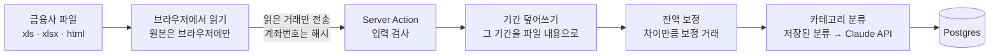

<div align="center">


<h1>Wonbook</h1>

**금융사 거래 내역 파일을 올리기만 하면 입력·분류·잔액 맞추기까지 끝나는 웹 가계부**

[](https://github.com/mivomad33/wonbook/actions/workflows/ci.yml)
[](https://wonbook.vercel.app/demo)
[](https://nextjs.org)
[](https://www.typescriptlang.org)
[](https://neon.com)

[운영 주소](https://wonbook.vercel.app) · [데모 보기](https://wonbook.vercel.app/demo) · [주요 기능](#주요-기능) · [동작 방식](#동작-방식) · [시작하기](#시작하기) · [개발 문서](DEVELOPMENT.md)

**한국어** | [English](README.en.md)

</div>

<br>

<p align="center">
  
</p>

## 소개

기존 가계부 앱에서는 은행·카드·증권사의 거래를 하나씩 손으로 입력하고 정리해야 했습니다. Wonbook은 금융사에서 내려받은 거래 내역 파일을 그대로 올리면 나머지를 알아서 처리합니다.

1. 금융사 사이트에서 거래 내역 파일(xls, xlsx, html)을 내려받습니다.
2. Wonbook에 끌어다 놓습니다. 여러 파일을 한 번에 올릴 수 있습니다.
3. 거래 입력, 중복 정리, 카테고리 분류, 잔액 맞추기가 자동으로 끝납니다.

구글 계정으로 가입해 쓰고, 로그인 없이 [데모](https://wonbook.vercel.app/demo)에서 가짜 데이터로 둘러볼 수 있습니다. 앱 화면은 한국어이고 국내 금융사를 지원합니다.

## 주요 기능

- **브라우저에서 파일 읽기**: 금융사 파일(암호 걸린 xlsx 포함)을 브라우저에서 읽고, 읽은 거래만 서버로 보냅니다. 원본 파일은 서버로 가지 않습니다.
- **기간 덮어쓰기**: 같은 기간을 다시 올리면 그 기간을 파일 내용으로 바꿉니다. 어디까지 올렸는지 신경 쓰지 않아도 중복되지 않고, 직접 손댄 거래가 지워질 때만 확인을 받습니다. 계정마다 마지막 업로드를 되돌릴 수 있습니다.
- **잔액 자동 보정**: 파일의 거래 후 잔액과 계산한 잔액이 다르면 보정 거래를 넣고 알려 줍니다.
- **AI 카테고리 분류**: 거래 내용으로 카테고리를 자동 분류합니다(Claude API). 한 번 고친 분류는 같은 가맹점에 다시 씁니다.
- **한눈에 보는 화면**: 자산 현황, 월별 수입/지출(최근 6개월 추이, 카테고리별 비중), 날짜별로 묶은 거래 목록을 제공합니다.
- **계정·카테고리 관리**: 파일 업로드가 없는 금융사나 빌려준 돈 같은 항목은 수동 계정으로 관리합니다. 카테고리마다 색과 아이콘을 고를 수 있습니다.
- **내보내기와 탈퇴**: 거래를 CSV로 내보낼 수 있고, 탈퇴하면 데이터를 지웁니다.

### 지원 금융사

| 구분 | 금융사 |
| --- | --- |
| 은행 | 하나은행, 국민은행, 카카오뱅크 |
| 카드 | 하나카드, 국민카드 |
| 증권 | 한국투자증권(일반·ISA) |

다른 금융사 계좌는 수동 계정으로 만들어 직접 입력합니다.

## 화면

<table>
  <tr>
    <td width="50%"></td>
    <td width="50%"></td>
  </tr>
  <tr>
    <td align="center">월별 수입/지출: 최근 6개월 추이와 카테고리별 비중</td>
    <td align="center">거래 목록: 날짜별 묶음과 카테고리 색</td>
  </tr>
  <tr>
    <td width="50%"></td>
    <td width="50%" align="center"></td>
  </tr>
  <tr>
    <td align="center">파일 업로드: 여러 파일을 한 번에, 업로드 되돌리기</td>
    <td align="center">모바일(375px)</td>
  </tr>
</table>

## 동작 방식



- 파일 형식은 금융사마다 다릅니다(엑셀, 확장자만 xls인 HTML, 암호 걸린 xlsx). 금융사별 파서가 같은 거래 형식으로 바꿉니다.
- 파일 머리의 조회 기간을 그 계정의 "정답"으로 보고 기존 거래를 바꿉니다. 같은 날 같은 금액 거래처럼 하나씩 비교해서는 구분할 수 없는 경우가 있기 때문입니다.
- 분류는 먼저 사용자가 고친 분류(같은 가맹점)를 쓰고, 남은 거래만 Claude API로 보냅니다. 사용자별·전체 하루 분류 한도가 있습니다.

## 개인정보와 보안

거래 내역은 민감한 정보라 처음부터 서버에 덜 보내고 덜 남기도록 만들었습니다.

- **원본 파일은 서버로 가지 않습니다.** 브라우저에서 읽고 거래만 보냅니다.
- **계좌번호는 저장하지 않습니다.** 서버 비밀 키로 만든 해시(HMAC-SHA256)와 끝 4자리만 저장하고, 거래 내용에 든 긴 계좌번호는 가립니다.
- **파일 암호는 암호화해 저장합니다**(AES-256-GCM). 운영 DB 백업도 받는 즉시 암호화합니다.
- **사용자 데이터는 서로 분리됩니다.** 모든 조회와 변경이 로그인한 사용자 범위 안에서만 일어나는지 통합 테스트로 확인합니다.
- **공개 저장소 검사**: push할 때마다 모든 커밋에서 비공개 파일, 금지 문자열, 비밀 값을 찾아 걸리면 push를 막습니다.
- **배포 결과물 검사**: 배포 전에 빌드 결과물에 비밀 값, 계좌 식별값, 개발 전용 경로가 없는지 확인합니다.
- 로그에는 오류 종류와 위치만 남기고 거래 내용·금액·계좌번호·이메일은 남기지 않습니다.

## 품질 관리

| 층 | 도구 | 확인하는 것 |
| --- | --- | --- |
| 단위 | Vitest, PGlite(프로세스 안 Postgres) | 파서, 잔액 보정, 분류, 화면 로직, DB 쿼리 |
| 통합 | Vitest, Neon 테스트 브랜치 | 권한, 사용자 분리, 업로드 상한, 분류 한도 동시 요청, 탈퇴 |
| E2E | Playwright(데스크톱·375px) | 로그인부터 업로드·분류·화면까지의 흐름, 데모 |

- **CI**: GitHub Actions가 모든 push와 PR에서 타입 검사, 린트, 단위 테스트, 빌드를 돌립니다.
- **배포**: `pnpm release` 하나로 배포합니다. 검사 → 커밋된 파일만 빌드 → 결과물 검사 → 배포 → 배포 뒤 점검 순서이고, 앞 단계가 실패하면 멈춥니다.

## 기술 스택

| 분류 | 기술 |
| --- | --- |
| 프런트엔드 | Next.js 16(App Router, Server Actions), React 19, TypeScript, Tailwind CSS 4, shadcn/ui(Base UI) |
| 백엔드·DB | Postgres(Neon), Drizzle ORM, 구글 로그인(OAuth + PKCE, 직접 구현) |
| 파일 읽기·분류 | SheetJS, cheerio, officecrypto-tool, Claude API |
| 인프라 | Vercel(호스팅, Web Analytics), GitHub Actions |
| 테스트 | Vitest, PGlite, Playwright |

## 시작하기

준비물: Node 24(`.nvmrc`), pnpm, Postgres DB(개발용), 구글 OAuth 클라이언트.

```bash
pnpm install
cp .env.example .env.local
```

`.env.local`의 값을 채운 뒤(변수 목록은 [개발 문서](DEVELOPMENT.md#환경-변수)) 개발 DB를 준비하고 개발 서버를 띄웁니다.

```bash
pnpm db:dev-reset
pnpm dev
```

http://localhost:3000 에서 엽니다. 개발 서버에서는 `/api/auth/dev-login?as=user1`로 구글 없이 시드 데이터가 든 테스트 사용자로 들어갈 수 있습니다.

테스트, DB 스키마 변경, 백업, 배포 등 자세한 내용은 [개발 문서](DEVELOPMENT.md)에 있습니다.

## 프로젝트 구조

<details>
<summary>주요 폴더</summary>

```text
src/
├── app/            # 화면과 라우트(App Router)
│   ├── (app)/      # 로그인 뒤 화면: 자산 현황, 월별, 거래, 업로드, 계정, 카테고리, 설정, 관리자
│   ├── api/        # 로그인·로그아웃, CSV 내보내기
│   └── demo/       # 로그인 없는 데모 진입
├── auth/           # 구글 로그인, 세션, 데모 사용자
├── components/     # 공통 UI(그래프, 요약 카드, 카테고리 배지 등)
├── db/             # 스키마(Drizzle), 마이그레이션 적용, 시드
├── lib/
│   ├── parsers/    # 금융사별 파일 파서
│   ├── import/     # 업로드 반영(기간 덮어쓰기, 되돌리기)
│   ├── balance/    # 잔액 보정
│   ├── categorize/ # 카테고리 분류(저장된 분류, Claude API, 한도)
│   ├── privacy/    # 계좌 해시, 계좌번호 가리기
│   └── reports/    # 자산·월별 집계
└── secrets/        # 파일 암호 암호화
drizzle/            # 마이그레이션 SQL(drizzle-kit 생성)
scripts/            # DB 마이그레이션·백업, 배포, 공개 저장소·결과물 검사
test/               # 통합·E2E 테스트
```

</details>

## Claude Code로 만든 과정

이 프로젝트는 [Claude Code](https://claude.com/claude-code)와 함께 문서 중심으로 개발했습니다.

- 기능마다 사람이 정할 것(범위, 비용, 공개 여부, 디자인)을 먼저 모두 정한 **자율 구현 명세서**를 쓰고, 요구사항마다 실행할 수 있는 확인 방법을 붙였습니다.
- AI가 그 명세서만 보고 끝까지 구현하고, 요구사항마다 테스트·브라우저 확인으로 근거를 남겼습니다.
- 공개 저장소 검사, 배포 결과물 검사, 브라우저 직접 점검으로 사람이 놓치기 쉬운 것을 기계적으로 막았습니다.

프로젝트 규칙은 [CLAUDE.md](CLAUDE.md)와 [AGENTS.md](AGENTS.md)에 있습니다.

## 라이선스

라이선스를 붙이지 않았습니다. 코드는 볼 수 있지만 모든 권리는 저작자에게 있습니다(All rights reserved).
